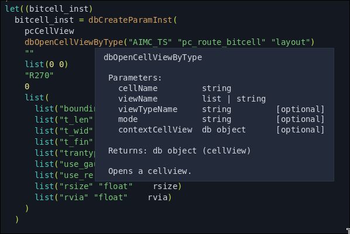
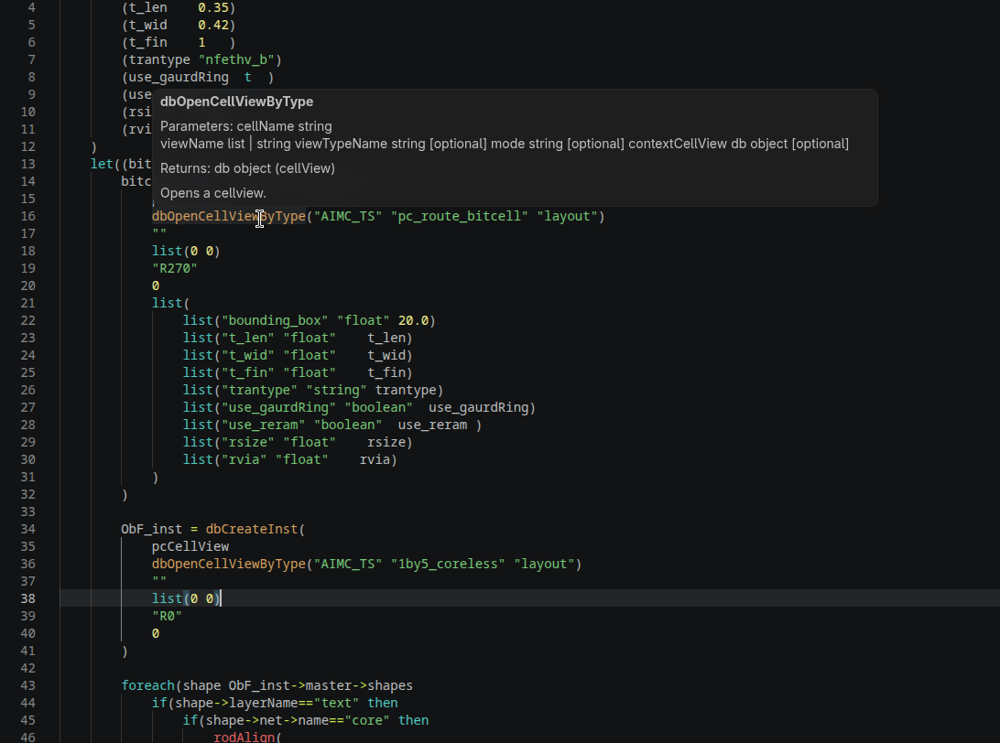

# SKILL LSP

A language server for Cadence SKILL that brings function documentation,
completion, and code navigation into your editor. Works with VS Code and
Lite-XL, using the Finder documentation from your own Cadence installation.

### Lite-XL



### VS Code



## Download

Open the repository's [Actions page](https://github.com/meyounge/skill-lsp/actions),
select a successful workflow run, and scroll to **Artifacts**.
You must be signed into GitHub to download these files.

Download and extract the server for your operating system:

| Operating system | Artifact | Executable |
| --- | --- | --- |
| Linux | `skill-lsp-ubuntu-latest` | `skill-lsp` |
| Windows | `skill-lsp-windows-latest` | `skill-lsp.exe` |
| macOS | `skill-lsp-macos-latest` | `skill-lsp` |

For VS Code, also download and extract `skill-lsp-vscode`, which contains the
`.vsix` extension installer. Keep the server executable in a permanent location.

On Linux and macOS, make the downloaded server executable:

```sh
chmod +x /path/to/skill-lsp
```

## Find your Cadence documentation

Finder files are usually located under:

```text
<Cadence installation>/doc/finder/SKILL/
```

That directory contains subdirectories with `.fnd` files. Point the language
server at the whole `SKILL` directory; it searches the subdirectories for you.
The layout may differ between installations.
[Cadence Finder directory reference](https://community.cadence.com/cadence_technology_forums/f/custom-ic-skill/29217/ocean-skill-xml-database).

If you do not know your installation root, enter this in Virtuoso's Command
Interpreter Window (CIW):

```lisp
cdsGetInstPath()
```

Append `/doc/finder/SKILL` to the returned path.
[Cadence installation path reference](https://community.cadence.com/cadence_technology_forums/f/custom-ic-skill/47193/how-to-get-the-skill-function-about-creating-a-new-pcell/1371646).

The documentation is not included with this project. You can use it directly
from your installation, or point the server at a local copy that preserves the
directory structure.

## Install in VS Code

1. Press **Ctrl+Shift+P** (**Cmd+Shift+P** on macOS), run
   **Extensions: Install from VSIX**, and select the downloaded `.vsix` file.
2. Open the Command Palette again and select
   **Preferences: Open User Settings (JSON)**.
3. Add these settings, replacing the example paths with your own:

   ```json
   {
     "skillLsp.serverPath": "/path/to/skill-lsp",
     "skillLsp.fndDir": "/path/to/cadence/doc/finder/SKILL"
   }
   ```

   If you already have settings, add the two entries inside the existing braces.
   On Windows, use `skill-lsp.exe` and forward slashes in paths, such as
   `C:/tools/skill-lsp/skill-lsp.exe`.

4. Open an `.il`, `.ils`, or `.skill` file. The language mode in the bottom-right
   corner should say **SKILL**; click it and choose **SKILL** if necessary.

The extension starts the server automatically. If it does not connect, run
**SKILL: Show Language Server Output** from the Command Palette to see the error.

## Install in Lite-XL

1. Install [lite-xl-lsp](https://github.com/lite-xl/lite-xl-lsp).
2. Open your Lite-XL user configuration directory. On Linux this is usually
   `~/.config/lite-xl`.
3. Copy [`editors/skill_lsp_config.lua`](editors/skill_lsp_config.lua) and
   [`editors/skill_colors.lua`](editors/skill_colors.lua) into its `plugins`
   directory.
4. In the copied `skill_lsp_config.lua`, set `SKILL_LSP_BIN` to the full path of
   your downloaded executable and `FND_DIR` to your Finder `SKILL` directory:

   ```lua
   local SKILL_LSP_BIN = "/path/to/skill-lsp"
   local FND_DIR = "/path/to/cadence/doc/finder/SKILL"
   ```

5. Add this to your Lite-XL `init.lua`, using the same paths:

   ```lua
   local config = require "core.config"
   config.plugins.skill_colors = {
     server_command = "/path/to/skill-lsp",
     fnd_dir = "/path/to/cadence/doc/finder/SKILL",
   }
   require "plugins.skill_lsp_config"
   require "plugins.skill_colors"
   ```

6. Restart Lite-XL and open a SKILL file.
